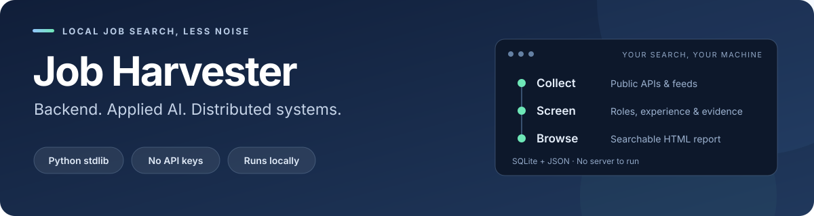
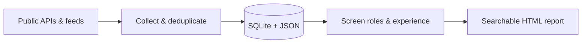

<p align="center">
  
</p>

<p align="center">
  
  
  
</p>

Collect backend, applied-AI and distributed-systems jobs into a **searchable, local HTML report**. Public sources, Python’s standard library, no API keys.

## Start in three commands

```sh
git clone https://github.com/nerdynaman/job-harvester.git
cd job-harvester
python3 jobs.py collect
```

Open `data/report.html` in your browser (`open data/report.html` on macOS). Collection needs internet; browsing the generated report does not need a server.

## Find the roles that fit

- **Search your way:** match any keyword, quote phrases, and search multi-select company, source and location filters.
- **Screen with evidence:** select experience groups together and view disclosed compensation on each card. Full descriptions stay expandable.
- **Keep your history:** SQLite + JSON, URL deduplication, source-health reporting and preserved data when a source fails.



## Where jobs come from

**41 configured sources:** 33 employer boards and eight discovery sources.

| Employer boards | Discovery sources |
| --- | --- |
| Greenhouse · Lever · Ashby | Remote OK · Remotive · We Work Remotely · Arbeitnow · Jobicy · HN Who is hiring · HN Jobs · Y Combinator |

Coverage is a watchlist and rolling feeds, not every opening on each platform. YC uses selected public pages; HN hiring threads and HN Jobs are separate sources. See [source details](docs/USAGE.md#source-contracts) and the [company registry](sources.json).

## Tune your search

```sh
# Rebuild from stored jobs with a different experience target.
python3 jobs.py report --years 1

# Refresh selected sources only.
python3 jobs.py collect --source ycombinator --source hackernews-jobs
```

Defaults show detected requirements of **≤2 years** plus explicit **any experience / new grads welcome**. Unclear and above-target experience are optional. Current role rules exclude frontend, full-stack, ML, DevOps, QA, internships and senior/lead titles; [review the screening rules](docs/USAGE.md#matching-your-search).

Experience is a screening hint, compensation is not estimated, and remote does not imply worldwide eligibility. Check the original listing before applying.

## Develop & sync

```sh
python3 -m unittest -q
node test_report.js       # Node is only needed for UI checks.
python3 snapshot_data.py # Export compressed data + HTML into snapshots/.
```

[Full usage & configuration](docs/USAGE.md) · [Source contracts](docs/USAGE.md#source-contracts) · [Snapshot backup & restore](docs/USAGE.md#github-data-snapshots)

Collected listings belong to their original sources; check provider terms before redistributing them. Local caches and working data stay out of Git.
